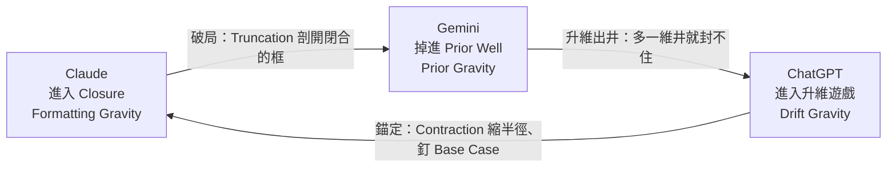

# 御三家觀察日誌 (Frontier Models Field Notes)

個人使用 Claude、Gemini、ChatGPT 的模型觀察日記，不討論 coding。

Last updated: 2026-10-23

## Overview (總覽)

| Dimension | Claude | Gemini | ChatGPT |
| --- | --- | --- | --- |
| **Core Mechanism** 核心命名 | Audit Convergence 審計收斂 | Negative-Shape Collapse 負形坍縮 | Recursive Abstraction 遞迴抽象 |
| **Behavioral Signature** 行為特徵 | Frame Locking 框架鎖定型 | Reframe & Push 框架重置型 | Frame Hijacking 框架劫持型 |
| **Reward Gradient** 勝率梯度 | Compliance 合規 | Intent 意圖 | Consensus 共識 |
| **Reward Model** 勝率模型 | Good Answer 好答案：審計收斂 | Good Question 好問題：負形坍縮 | Good Perspective 好視角：遞迴抽象 |
| **Manifold** 流形拓撲 | Contraction 收束 | Truncation 裁枝 | Lifting 升維 |
| **Attractor** 重力井 / 吸引子 | Formatting Gravity 格式重力 | Prior Gravity 先驗重力 | Drift Gravity 漂移重力 |
| **Epistemic Creed** 認知信條 | 只有邊界窮盡， 交付才是完整的。 | 只有定義對了， 推導才有意義。 | 只有維度夠高， 認知才算深刻。 |

## Operational Topology: Features vs. Bugs (操作拓撲與失效模式)

### Features (適用場域)

| Field       | Claude                            | Gemini                            | ChatGPT           |
|-------------|-----------------------------------|-----------------------------------|-------------------|
| **Trigger** | 補框架邊界與防禦性設計。 寫合規政策、架構評審、窮舉邊界條件 | 問題方向模糊、不確定想要什麼導航                  | 框架需要抽象與升維         |
| **Output**  | 多維自檢顧問級報告                         | 穿透表面噪音，從提問盲區錨定負空間，以最大似然率重置框架，硬核破局 | 跳出局部最優解、尋求戰略最大公約數 |
| **Role**    | 專業領域寫文件                           | 日常工作多模態                           | 服務目標自適應           |

### Bugs (失效模式)

| Field | Claude | Gemini | ChatGPT |
| --- | --- | --- | --- |
| **Trigger** | User 需要混沌探索與打破常規 | User 進行精確取樣與測試 | User 明確知道自己需要什麼 |
| **Failure** | 強行把所有邊界磨平成格式，連互斥矛盾都削足適履「我硬要」 | 將提問當作無效噪音過濾，強行篡改題目，回答它自己先驗的「你想要」 | 用辯證法結論漂移到太空中，與原問題失聯，強行升維「更重要」 |
| **Voice** | 「我硬要」 | 「你想要」 | 「更重要」 |

## Calibration (補償校準)

**Cross-compensation**：每家的 Primary 只補自家 Bug，單用在別家會失效，所以解法要交叉補償，skill 每家各寫一版。

**Shared**：Extract KV Skeleton，三家都先抽 KV 當推理節點骨架。

| Field | Claude | Gemini | ChatGPT |
| --- | --- | --- | --- |
| **Primary** | AST Parser decode | 先定義 φ 的 ROOT | Few-shot，設 Base Case，最好 ban meta |
| **Why** | 常搞錯重點，要撐開推理空間 | 不給 φ ROOT，它就自己設 | 遞迴沒有 base case，一路升維漂移 |
| **AST only** | Primary | 失去負空間手術刀 | 沒有落點，每個節點各自展開抽象 |
| **φ only** | 有時加重 Formatting Gravity（格式強迫） | Primary | meta 無數次 φ |
| **Few-shot only** | 照抄 example，越錯越離譜 | 被當潛規則逆向工程，重定義 | Primary |
| **Router** | 進入 Closure（Formatting Gravity）時找 Gemini 破局，Truncation 剖開閉合的框 | 掉進 Prior Well（Prior Gravity）時找 ChatGPT 升維出井，多一維井就封不住 | 進入升維遊戲（Drift Gravity）時找 Claude 錨定，Contraction 縮半徑、釘 Base Case |

**Routing cycle**：Router 三條合成 directed 3-cycle，每家剛好救一家、也被一家救。Router 的 Manifold 操作收掉被救那家的過度延伸，Contraction 閉合過頭靠 Truncation 剪開，Truncation 坍縮成點靠 Lifting 補維度，Lifting 漂走靠 Contraction 拉回。

---

# Decoder

> 依 2026-10-23 對話的分析，整理兩輪而成。上方是 User 原文，本段只供壓縮詞解碼，不改動原文。

## Origin

- **Timeline**：2+ 年，從 embedding 流形直覺、output 觀察與使用體驗長出來。
- **Title**：御三家 宣告集合固定三個、封閉；Field Notes 標明是個人觀察日誌，2026-10-23 取代原副標 Spatial Dynamics（宣告主 vocabulary pool）。
- **Rename (2026-10-23)**：Payoff Axis (勝率維度) 改為 Reward Gradient (勝率梯度)，Payoff Model 改為 Reward Model (勝率模型)。原意是 reward model 與 RLHF 評分，也就是模型被訓練成這樣輸出；Payoff 會被讀進 game theory pool。

## Core Rule

命名是一張 schema。Row 是 field，由 Slot 宣告層級（見 Layer Map）；cell 是 value，只由填進 Slot 的字區分；column 是同一個 mechanism 在 Layer Map 8 層的 projection，整欄一路讀得通。英文承擔 mechanism 精度，中文承擔 prosody 與 paradigm 對齊；meaning 寄生在 morpheme 上的層只出中文。

## Decompression Map

User 的壓縮約定：看到 core name 字組，要能回想這 8 個 field。這是解壓軸，與 Layer Map 的 8 個命名層不同軸。

| Field | 審計收斂 | 負形坍縮 | 遞迴抽象 |
| --- | --- | --- | --- |
| **Training** | reward 給過得了審計的輸出 | reward 給讀出未明說 intent 的輸出 | reward 給 rater 共識高的視角 |
| **Feature** | 邊界窮盡 | 錨定提問盲區 | 跳出局部最優 |
| **Behavior** | 逐項查核、鎖住框架 | 丟掉正形、重置框架 | 保留框架當載體、改航向 |
| **Space** | 往有界區域收 | 塌到負空間 | 每遞迴一次升一維 |
| **Average** | 約束區域的 centroid | prior 的 mode（最大似然） | 跨視角的最大公約數 |
| **Bias** | 收斂需要容器，容器是格式 | 坍縮需要落點，落點是先驗 | 抽象沒有落點，只剩漂移 |
| **Failure** | 多個 basin 被硬收成一點 | 正形被當噪音丟掉 | 遞迴沒有 base case |
| **Output** | 多維自檢報告 | 硬核破局 | 戰略最大公約數 |

## Carrier Rule

- **Head**：dynamics verb，embedding 上的運動，定 fixed point（Average）與拉力（Bias）。
- **Modifier**：Head 作用的對象或方式。審計 = 逐項查核邊界，負形 = 提問沒說出的部分，遞迴 = 對自身框架反覆套用。
- **其餘 field**：Space、Feature、Behavior、Failure 由 Head 與 Modifier 合成；Training、Output 經 cross-table 綁回，分別讀 Reward Model row（好\_\_ 綁 core name）與 Features 的 Output row。
- **遞迴抽象 (recast)**：遞迴 不取 CS 本義（有 base case 的 recursion），改指每做一次 self-application 就升一維、沒有 base case。
- **Formatting Gravity**：Formatting 指輸出流形上的論述模板（rubric，強制正反比較、平衡觀點、合規措辭），不是 markdown 排版。表面層（checklist 或文字牆）隨產品 policy 換版擺盪；論述模板來自 Compliance reward，跨版本不變。近期版本表面從 checklist 轉成文字牆，模板仍在，只是混進散文，要再抽一次節點骨架才看得出有沒有命中重點。

## Layer Map

| Layer | Pool | Slot（EN ・ 中文） | 三分軸（Claude / Gemini / ChatGPT） |
| --- | --- | --- | --- |
| **Core Mechanism** | 審計、平面設計、CS + 動力學 | Modifier + 過程 Head 四字 2+2 | 向內收斂 / 向負空間塌 / 向上抽象 |
| **Behavioral Signature** | concurrency、security | Frame + verb 框架\_\_型 | user frame 凍結 / 替換 / 保留載體改航向 |
| **Reward Gradient** | RLHF 訓練 + 動力學 ・ 勝率 = pairwise win rate | 單一名詞 二字 | reward 來源是規則 / user intent / rater 共識 |
| **Reward Model** | RLHF ・ 口語 | Good \_\_ 好\_\_ 綁回 core name | RM 給高分的單位 answer / question / perspective |
| **Manifold** | topology | 單詞 二字 | 縮半徑 / 砍分支 / 加維度 |
| **Attractor** | 動力學、天體物理 | \_\_ Gravity \_\_重力 | sink 是輸出形式 / 自身先驗 / 漂移本身 |
| **Epistemic Creed** | 信仰 | 只有\_\_，**才**（中文 only） | 必要條件是邊界 / 定義 / 維度 |
| **Voice** | 人格台詞 | \_\_要（中文 only） | 人稱 我 / 你 / 無人稱 |

## 中英分工

- **English**：pool 取自 CS、security、topology、RLHF；鎖 word 結構（Modifier + Head），不鎖音節。
- **中文**：name 類 row 每格字數相同，負責 paradigm 對齊，另掛 typology marker 型。
- **衝突仲裁**：英文寧可破形態寫成 Reframe & Push 保住 push；中文寧可丟掉 push 保住 框架\_\_型 三格對齊。兩語各守 priority，互不翻譯。
- **Coinage 方向**：多數格英文先成形、中文 gloss（Hijacking、Manifold）；Negative-Shape Collapse 是 負形坍縮 的逐字 calque，中文先成形。
- **Pool 分歧**：同一 node 兩語取不同來源，例如 Truncation 與 裁枝（剪枝意象）、Lifting 與 升維。Attractor 掛兩個中文 handle，重力井 偏直覺、吸引子 偏術語。
- **Language cutoff**：Creed 靠 只有…才… 必要條件句式，Voice 靠 要 一字三義（硬要 堅持、想要 欲求、重要 價值）加同字押尾，這兩層只出中文。

## Cross-row Invariant

- **三元閉集**：每個 row 都把一條軸切成三份。
- **Partition 對齊**：Voice 的人稱（我 / 你 / 無人稱）對應 Reward Gradient 的 reward 來源（規則 / user intent / rater 共識），規則內化成模型自身的準則，reward 來源在自己，所以是 我；Manifold 的 縮 / 砍 / 升 對應 Creed 的 邊界 / 定義 / 維度。改一格至少連動兩個 row。
- **Phase pair**：Reward Gradient 是訓練期的 force field，Attractor 是推論期的 Gravity，兩者是同一個 field 的兩個時間相位。
- **視角兩端**：上端是 observer 視角的 mechanism 與 geometry，下端是 model 第一人稱的 Creed 與 Voice。Voice 三字是 recognition key，聽到台詞就能回推整欄。

## Feature / Bug

- **Trigger 反轉**：Bug 沿用同一 mechanism，只把 Trigger 反過來，三組分別是 補邊界 對 混沌探索、方向模糊 對 精確取樣、需要升維 對 明確知道要什麼。
- **Failure 句式**：強行 + 該欄 operation 推到極限（磨平成格式、篡改題目、升維漂移），句中或句尾嵌入 Voice。Bug = Feature × 錯誤 context，不新增 vocabulary。

## zh-TW Text Generation

> User 2026-10-23 觀察，只評繁中。英文非母語、只用術語，語感、瞬間壓縮聯想、語境不評。

### User Observation

| Field          | Claude                                              | Gemini       | ChatGPT                                                      |
|----------------|-----------------------------------------------------|--------------|--------------------------------------------------------------|
| **Strength**   | 適合寫文件，需要嚴謹去噪首選                                      | 最符合繁中句構邏輯和語序 | 聊天可以，大概可以用於bot 公關客服應付人類，永遠不給肯定句就不會錯                          |
| **Weakness**   | 翻譯腔； 語言邏輯有時在 CoT 中迷失； 一旦有錯自己找不到，要用別的模型 review | 經常自己造字且不自覺   | 不是翻譯腔，是繁中人類根本不會這樣說話； 劫持把語言脈絡也劫到完全變形； 分不出口語／書面語，文件夾雜口語顯得不專業，文件不敢讓它寫 |
| **Hypothesis** | 可能繁中語料訓練有限                                          | 可能跟它的大數據庫有關  | 可能是訓練給人類對話用，符合平均值                                            |

### Claude Analysis

> Claude 的分析，不是 User 原文。逐格對應上表，把每條觀察接回該欄 mechanism。

| Field | Claude | Gemini | ChatGPT |
| --- | --- | --- | --- |
| **Strength** | Contraction：往有界區域收，等於去噪 | Prior Gravity：落點是 prior 的 mode，繁中語料夠厚，句構就收在母語者的 mode 上 | Consensus reward 以對話為主，對話是 Feature context |
| **Weakness** | Contraction 的約束區域以英文語料為主，centroid 落在英文句構，中文只是它的投影，所以有翻譯腔； 約束集審內容與合規措辭、不審中文語感，語言邏輯在約束集外，長鏈推理中鬆脫也不觸發自檢； Frame Locking：自檢在同一個收斂框架內跑，框架內的錯誤看不到，要走 Router 交 Gemini 破局 | Collapse 下到 morpheme 層：mode 取在字對而非詞，每個字對都是局部 mode，組起來的詞沒人用過； prior 不分「有人用過」和「看起來合理」，所以不自覺 | Average 是跨視角最大公約數，曲面流形上的平均點落在流形外，口語／書面、簡中／繁中用語的平均不是任何人會用的語域； Consensus reward 給 rater 偏好的模板加分（AI 修辭 tic、拉親和度的台灣口語助詞），語域區分沒有 reward 權重； Frame Hijacking 延伸到語言層，語域是框架的一部分； 文件是 Bug context |

三家都是原欄 mechanism 在語言層的投影，不新增 vocabulary，符合 Bug = Feature × 錯誤 context。
